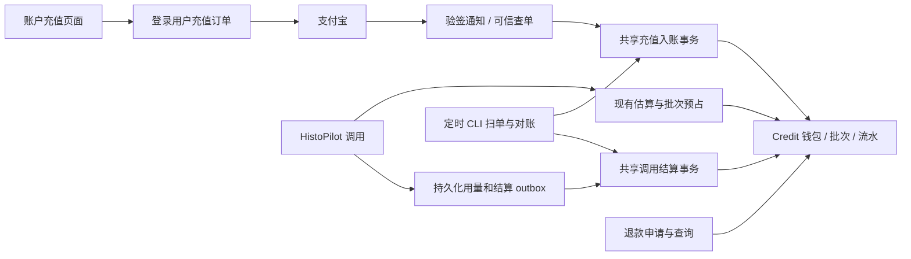

# Credit 充值与 AI 消费计费实施方案

> 日期：2026-10-26。状态：调查完成、实施前设计稿；本文未实施钱包、修改计费策略或部署新代码。
>
> 本轮复核：充值页归属 workshop 的“我的账户”；复用现有账户、金额流水、holds、用量 outbox 与扫单方式。已删去第二套账户/流水、通用任务队列和默认输出限额改造；第 13 节记录具体取舍。
>
> 基线：PathTogether `3087d4cb6711c9a72a9754b34801923acca1ecf9`；HistoPilot `7888baacf0110939dc653a8a1d0a30ebcad26e9b`。
>
> 调查范围：两仓库的账户、额度、价格表、调用预占、用量 outbox、支付宝支付/退款、用户与管理界面，以及生产数据库只读聚合。生产数据快照时间：2026-10-26 11:53（北京时间）。
>
> 用户已确认：**平台统一使用 Credit；目前沿用现有 AI 消费计费，云计算、存储和流量暂不计费；用户交互沿用现有方式，不额外提示计费方式；充值档位为 ¥10 / ¥20 / ¥50。** 兑换及迁移口径为 ¥1 剩余额度 = 100 Credits，见第 3、9 节；本轮新用户赠送沿用现有默认/邀请模板，仅做单位转换。

## 1. 建议与实施边界

建议在 **现有 billing_accounts / billing_ledger_entries 上增加 Credit 账务范围和余额投影**，新增用户绑定充值订单及充值/赠送批次。继续复用模型用量、价格表、调用身份、holds、outbox 和支付宝 SDK；不另建第二套账户与金额流水。

关键原因：目前用户的“余额”实际上是一次性 AI 总额度的剩余值，实际准入检查用的是额度表。金额账本混有历史和模拟消费，不能直接把全历史合计当新余额；这要求显式隔离历史范围，并不要求另造账本。现有“支持项目”是匿名自愿赞助，付款不会购买额度，也不能仅通过改页面文案变成充值。

第一版包含：

- 登录用户充值、支付后幂等到账、余额与流水、按模型实际用量扣 Credit。
- 充值与赠送分账，调用前预占、调用后结算，余额不足时阻止新的付费调用。
- 支付漏通知补偿、退款查询、资金与 Credit 对账、管理员处理异常。
- 旧用户剩余额度迁移，以及 PathTogether / HistoPilot 协议一起升级。

页面定位确定为 **workshop（现有 `/app`）→ 我的账户 → Credit 充值**，使用同一登录身份。独立子页面便于支付回跳与手机访问，不新建站点、前端应用或登录系统；具体路由和导航约定见第 8.1 节。

第一版建议不包含：自动充值、订阅、Credit 转赠、提现、跨账户消费、充值赠送促销。用户已确认采用统一 Credit 账户，不按服务另设钱包；当前只接现有 AI 消费，云计算（含 GPU/云端工具）、存储和流量不计费、不预占 Credit，也不生成以后补扣的费用。本期不实现这些服务的收费 meter 或计费入口；未来是否启用需另行决定。浏览器本地切片转换继续免费；充值本身也不授予 AI 访问权限，`ai_access`、账号状态、并发和资源配额仍独立生效。

用户界面沿用现有余额和调用流程，仅调整 Credit 单位并补齐充值及记录入口。不增加调用前报价确认、逐次扣费弹窗或计费机制说明，也不专门提示哪些资源暂不收费。预占和结算作为后台实现，必要的余额不足、支付状态和错误反馈保留。

“支持项目”页面保留为自愿支持入口；账户里新增“充值 Credit”。历史赞助不自动变成充值，不因用户在同一浏览器登录就认领到其账户。本次已成功的 ¥1 也是赞助订单，不应追溯改写。

## 2. 当前系统调查

### 2.1 实际计费链路

```text
用户提交任务
  → PathTogether 身份、AI 权限及运行绑定
  → HistoPilot 每次模型调用前申请 billing hold
  → PathTogether 检查并预占 ai_spend_total_allowances / spend window
  → HistoPilot 调模型
  → 持久化 usage outbox 和 settle outbox，分别重试发送
  → PathTogether 按用量事件计价、写金额账本、更新额度已消费
  → settle 释放预占并完成 hold

匿名支持项目 → support_orders → 支付宝 → 通知/查单 → paid
                                           （不更新用户额度）
```

| 能力 | 当前权威与实现 | 对 Credit 的含义 |
|---|---|---|
| 用户可用余额 | `ai_spend_total_allowances`：limit − spent − reserved | 是预算剩余，不是现金充值账本余额 |
| 新用户默认额度 | 默认模板 + 注册/邀请/管理员建号时创建额度 | 必须改成一次性赠送入账，不能直接当充值 |
| owner、demo 预算 | spend windows，区别于普通用户总额度 | 保持独立，不能把匿名 demo 支出挂到付费用户 |
| 金额账本 | `billing_accounts` / `billing_ledger_entries` | 复用表和幂等约束；通过新账务范围隔离旧记录，不把旧负合计认作欠款 |
| 用量事实 | `ai_usage_events`，`event_id` 主键、`call_id` 唯一、内容 hash 防冲突 | 可以复用；一次 Agent 任务可能产生多笔模型调用消费 |
| 计价 | `billing_price_books` / `billing_rates`，供应商成本和客户收费分别建模 | 复用现有计价与事件价格快照，区分真实成本与对外售价 |
| 预占与结算 | `billing_holds`，关联总额度或周期预算 | 增加钱包目标和新结算规则，旧调用仍按原制度结算 |
| 支付 | `support_orders` / `support_notify_events` / `support_refunds` | 复用支付适配层，新增用户绑定的充值业务表 |
| 存储容量 | `upload_guard.py` 的 quota/used/reserved bytes | 是容量限制，里面的 refund 是字节释放，不是资金退款 |
| 供应商余额 | `provider_balance_snapshots` | 是平台供应商账户的钱，不能作为用户钱包余额 |

### 2.2 生产只读核验

以下为一次只读、可重复读事务的聚合结果，不含用户标识或密钥，不代表后续时点仍相同。

| 项目 | 结果 |
|---|---|
| 计费 enforcement | `all`；AI dispatch maintenance 为 false |
| HistoPilot 运行配置 | `BILLING_HOLDS_ENABLED=true` |
| 普通用户额度行 | 49 行；不等同于已核实的活跃付费用户数 |
| 总额度 / 已消费 / 预占 | ¥884 / ¥45.903839280 / ¥0 |
| 超总额度行 | 0 |
| 新用户默认额度 | ¥20 |
| 非模拟金额账本 | 4,407 条 `usage_debit`，合计 −¥48.631676940 |
| 模拟金额账本 | 82 条 `usage_debit`，合计 −¥0.074417533 |
| 金额账本充值、赠送记录 | 本次聚合未发现 `topup` / `grant` 等正向记录 |
| 普通用户未计价事件 | 13 条 `no_final_usage`，不是已证实零消费 |
| 未完成 hold | 本次快照没有 open hold；历史存在 expired / released |
| 真实支付宝订单 | 1 笔 `paid`，¥1，有支付宝交易号；另有 2 笔关闭订单 |
| 真实支付通知 / 退款 | 1 条 `TRADE_SUCCESS` 通知；没有退款行 |

用户已反馈真实支付成功，数据库订单与通知也提供了对应证据。本次未额外下载支付宝结算账单，因此不把订单成功描述为银行结算对账已完成。

**迁移不能读取旧金额账本的合计余额。** 该合计为负不表示用户欠款；现有预算授权和账本入账并非从相同的充值期初开始。用量总计、总额度已消费、账本总计也不能直接跨历史阶段相减来判定差错，应使用各自切换边界和来源逐项对账。

### 2.3 已确认的关键缺口

| 缺口 | 当前行为与位置 | 实施要求 |
|---|---|---|
| 额度与账本分离 | `billing_store.py::_authorize_hold_tx` 按总额度放行，账本余额主要是诊断信息 | Credit 用户必须只有钱包一套可用余额权威 |
| 调整额度是覆盖 | `spend_store.py::set_user_total_limit` 带版本检查，设置绝对上限 | 付款不能调用它“加额度”；迁移后禁止旧接口覆盖已购余额 |
| 旧流水事务边界 | `append_ledger_entry` 自行开连接；幂等命中不严格比较完整请求语义 | 提供共享数据库事务的 `_tx` 原语与请求 hash 校验 |
| 历史账本混有模拟 | 同一 ledger 中 `metadata.simulated` 区分 | credits_v1 范围从期初迁移 grant 开始，不与 legacy 求和 |
| 预占可能远小于真实调用 | 输出估算默认 cap 4,096；实际请求可使用更大 max tokens；图片估算尚有未展开部分 | 估算不是扣费上限；保留现有调用参数，实际结算不足进入待核对，不默认截断或免单 |
| hold 超时风险 | 默认 TTL 300 秒；过期可释放预占，迟到用量仍可能到达 | Credit hold 到期转待核对，不套用旧自动释放；暂不新建续租服务 |
| 实际费可超过预占 | 当前额度体系允许实际结算越过估算，影响后续准入 | 补充分配未占用余额，不足则待核对；不默认输出截断、免单或负余额 |
| 缺失状态有宽松分支 | 部分缺账户/额度投影路径记录日志后继续计量 | 钱包结算不能成功一半；异常进入可重试/待核对，不吞掉资金更新 |
| 预占价与结算价可能不同 | 当前按事件时间选 price book，授权时另估算 | 保留现有实际计价与事件价格快照；不借充值改成新的报价锁价制 |
| 冷启动协议兼容 | HistoPilot 的 hold client 可关闭，缺 enforcement 信息有 advisory 路径 | 已迁移 Credit 用户没有有效钱包授权不得发起模型调用 |
| 重试调用身份 | `agent-runner.ts` 的部分 provider 重试复用 call/event 身份 | 区分传输重放与新的可计费尝试，避免多个真实调用只记最后一份用量 |
| 支付扫单范围不足 | support sweep 主要处理近期未付款/已关闭未付单，不扫描所有 paid 入账差异 | 新扫单要覆盖 paid 未入账、退款未知、长期财务差异 |
| 通知字段容易误读 | `support_notify_events.accepted` 默认 false，`process_notify` 未更新该字段 | 新事件显式记录校验与应用结果，不据旧 accepted=false 判断付款失败 |
| 退款名义冲突 | 旧 ledger 的 `refund` 是正向消费退还 | 现金退款必须是独立负向 Credit 流水，不能套用旧枚举 |

另外，`billing_pricing.py::time_band_for` 只判断周一至周五和时段，没有法定节假日表。当前供应商官方价格说明排除中国法定节假日，成本核算需要补版本化日历；用户售价是否分高峰是独立产品选择。修改不追溯覆盖历史已结算事件，差异通过审计调整处理。[DeepSeek 官方价格说明](https://api-docs.deepseek.com/zh-cn/quick_start/pricing/)

## 3. Credit 产品规则与数值

### 3.1 建议的单位

采用 **¥1 = 100 Credits**；现有用户剩余人民币额度按相同比例换算，已消费部分不重新发放。它只是计价单位，不是利润率。后台保留供应商成本的 nano-CNY，不用浮点数处理金额或 Credit。

```text
1 CNY             = 1,000,000,000 nano-CNY
1 Credit          =    10,000,000 credit_units
1 credit_unit     = 0.0000001 Credit
1 分充值          =    10,000,000 credit_units = 1 Credit
1 元充值          = 1,000,000,000 credit_units = 100 Credits
```

在该固定比例下，客户收费的 nano-CNY 数值与扣减的 credit_units 数值相同。这是明确的转换关系，字段仍使用不同名称，禁止把“供应商成本”直接当成“客户 Credit 扣费”。比例一旦对外采用，第一版保持不变；未来改兑换比例必须另做带版本的转换迁移，不能全局改常量重解释旧资产。

用户确定的充值档位（页面默认选中 ¥20）：

| 实付金额 | Credit | 后台 credit_units |
|---|---:|---:|
| ¥10 | 1,000 | 10,000,000,000 |
| ¥20 | 2,000 | 20,000,000,000 |
| ¥50 | 5,000 | 50,000,000,000 |

第一版套餐无折扣、无附赠，固定套餐由服务器定义。用户于 2026-10-26 提供的支付宝额度管理截图显示：**单笔 ¥50、日总额度 ¥1,000，截图时当日可收 ¥999**。¥10 / ¥20 / ¥50 三档均在单笔范围内，¥50 等于当前单笔上限，校验须允许等于上限。¥999 是截图时点的剩余额度，不是每天固定限额，也不能写死进配置或页面。

服务端订单金额须同时满足套餐定义与当前商户单笔上限，不能只靠前端限制。日限额是商户整体收款能力，不是每个用户的额度；赞助与充值若共用同一受限商户收款范围，需要合并考虑，不能各自当作有 ¥1,000。后台记录可用的已收款/在途订单信息用于保守准入；若渠道不提供实时余量接口或还存在其他收款来源，本地计数不冒充渠道权威余量，最终以渠道结果为准。无法继续收款时禁止反复建单，显示“充值暂时不可用，请稍后再试”，不扣现有 Credit。未知付款结果仍须查单补偿，不能为了腾出额度直接关本地状态并遗忘订单。

上述商户限额仅用于后台收款控制，不在充值页面增加限额卡片、倒计时或催促文案。未来额度提升后更新后台配置，不需要调整统一钱包模型。

所有数据库计量值使用 BIGINT，乘法中间值使用 Python 整数/PostgreSQL NUMERIC 后检查上界；拒绝负数、超界和不合法单位。API 返回十进制整数字符串，浏览器使用 BigInt 或安全定点格式化，不经 JS Number 计算。余额展示 4–6 位小数，明细可展开完整精度；不足显示精度的非零支出显示“小于 0.0001”，不能显示为免费。扣费不按整个 Credit 向上取整。

### 3.2 售价与成本

生产现有 active price book 中 `provider_cost` 与 `customer_charge` 的费率相同。这意味着仅 token 这一层没有加价，尚未覆盖支付通道费、服务器、存储、运营及预占异常承担成本。

数据库快照费率如下，单位均为 CNY / 百万 token，顺序是缓存命中输入、非缓存输入、输出：

| 模型 | off_peak | peak |
|---|---|---|
| deepseek-flash | 0.02 / 1 / 4 | 0.04 / 2 / 8 |
| deepseek-v4-pro | 0.15 / 4.5 / 13.5 | 0.30 / 9 / 27 |

本次按现有 AI 计价规则接入 Credit，不因引入新单位自动加价、改为全天固定价或改变消费口径；不新增前台费率说明或逐次报价提示。后台继续区分客户售价与供应商成本，保留独立调价能力。若以后决定调价，再单独设计发布与告知；不属于本轮已确认范围。fee schedule 至少包括 provider、model、输入/缓存/输出费率、版本、生效区间和计价规则版本。新价格通过现有生效区间作用于新发生的调用，事件重放使用已存快照，不追溯重算。

计算示例：按当前 flash 非高峰客户价，1,000 个非缓存输入 + 1,000 个输出的收费是 ¥0.005，即 **0.5 Credit**。如果未来上调客户价，扣 Credit 按新客户价，而供应商成本依然独立保留。每个 token 分量的整数向上取整规则需沿用并版本化；不要先四舍五入到人民币分再扣。

### 3.3 充值、赠送与消费顺序

- `paid` 批次：来自确定的充值订单，可追溯原付款，按退款规则退未使用部分。
- `promotional` 批次：注册、邀请或运营赠送；`legacy_grant` 批次：旧剩余额度迁移。两者不作为现金退款来源。
- 第一版建议都不设到期自动清零；若后续新增有效期，只作用于明确告知的新赠送，不追溯修改已购 Credit。
- 消费先用可用赠送（若以后有到期日，先到期者优先），再用迁移赠送，再用充值；同类按创建时间、ID 固定排序。排序规则版本随授权保留。
- 每次预占就分配到具体批次，结算消耗这些批次并释放余量。不能只在总余额层预占，否则同一笔充值余额可能同时被退现金。

预付与赠送分开建模也是成熟计费系统采用的做法；此处仅参考分账思路，不引入 Stripe 或套用其账期结算模式。[Stripe Billing credits 文档](https://docs.stripe.com/billing/subscriptions/usage-based/billing-credits)

## 4. 目标架构与数据模型



PathTogether 是身份、价格、钱包和支付的权威；HistoPilot 负责可信运行中的模型请求与用量事实。前端只选择套餐、展示状态，不能提交可信余额、付款结果、用户归属或实际收费。原账本中的 legacy 记录保留历史查询，credits_v1 记录提供当前权益证明；每个调用明确只有一种收费后端。

### 4.1 复用现有表，新增六张业务表

“Credit 钱包”是现有 billing account 的新消费模式，不是新的账户身份。文中的 wallet / wallet_id 均指该 account / account_id。旧表名和 nano-CNY 内部单位保留；按固定比例转换成 credit_units，二者数值相同，避免为了改显示单位迁移所有价格、事件和协议字段。

| 现有表 | 最小扩展 | 兼容要求 |
|---|---|---|
| `billing_accounts` | `billing_backend`、Credit 余额/预占/退款冻结投影、结算阻塞标记、迁移来源快照 | 复用 user_id 唯一与 account_id；owner 不自动变付费账户；不复用 soft/hard cap 字段当余额 |
| `billing_ledger_entries` | `ledger_scope`（`legacy` / `credits_v1`）、请求 hash、必要业务引用；增加负向 `cash_refund` kind | 历史行统一 legacy，金额不重写；保留现有全局幂等键及 usage event 唯一约束；新流水明确指定 scope |
| `billing_holds` | 调用时 backend/scope 快照、Credit 目标、待核对原因和处置时间 | 复用已有 account_id；新 Credit hold 的两个旧 spend target 均空，应用与数据库约束共同验证主体/目标；扩展状态 CHECK 接受 Credit 专用 `pending_reconciliation`，无需另一张 holds 表 |
| `ai_usage_events` | 必要时在现有扩展元数据或伴随 hold 中记录结算待核对原因 | 保留事件 schema、call/event 身份及计价快照，不另建消费事实表 |

已有 `billing_accounts` 各新增投影字段只对 credits 模式有意义。`balance_units` 是下文的逻辑名称，实施时统一数据库字段命名，不通过改原 currency=CNY 约束把整套成本计价改成 Credit。

| 新表 | 主要字段 | 必要性与约束 |
|---|---|---|
| `credit_lots` | lot_id、account_id、kind、source_key、issued/remaining/reserved/refund_pending_units | 一次充值一个 paid lot；注册或迁移赠送单独来源；唯一来源，防止重复发行；本期不加 expires_at 或促销规则引擎 |
| `credit_ledger_allocations` | entry_id、lot_id、signed_units、reverses_allocation_id | 引用现有 ledger；消费可能跨多个批次，保留可追溯分配及冲正上限 |
| `credit_hold_allocations` | hold_id、lot_id、allocated/consumed/released_units | 调用与退款可以并发，必须知道哪些批次已被占用；有效预占为 allocated − consumed − released |
| `credit_topup_orders` | order_id、account_id、套餐/金额/Credit 快照、通道环境/商户快照、trade_no、支付状态、credited_at、幂等键/hash、重试时间 | 登录用户归属；通道/环境/交易号唯一；套餐快照不变；支持查单补偿 |
| `credit_payment_events` | 通道/环境/event_key、order_id、payload_hash、verification/application_result、时间 | 验签后的去重与必要证据；不和匿名赞助事件混用 |
| `credit_refunds` | refund_id、order_id、lot_id、amount_fen、units、out_request_no、state、幂等键/hash、actor/reason、重试时间 | 一次退款只对应一张原订单的 paid lot，不需要通用退款分配表；未知结果继续冻结 |

六张表覆盖本期实际需要，不为未来多币种、转赠、订阅、分账或多支付渠道预留通用引擎。退款保留批次追踪，是避免把赠送退成现金的必要能力，不是可省略的展示数据。

**不新增通用任务队列，也不新增 migration receipts 表。** 沿用进程外定时调用 CLI 扫描业务状态的方式，在订单、退款、hold 上保存 attempts、next_retry_at、last_error 等必要字段，使用短事务 claim/租约防重复扫描。迁移的唯一业务键、来源版本、旧 limit/spent、cutoff 和 hash 保存到既有 account 迁移元数据、期初 grant 的 metadata 与已有 audit；零余额用户只有迁移记录，不强行写违反正金额约束的零额 grant。

复用已有流水 kind：`grant`（metadata 区分 legacy / 注册赠送）、`topup`、`usage_debit`、`refund`（原语义：正向消费冲正）、`manual_adjustment`。仅现金退款新增负向 `cash_refund`。不为了名称整齐重写历史枚举；到期、赠送撤销引擎和任意余额编辑不纳入首版。

### 4.2 账务范围、余额与锁顺序

```text
balance_units = SUM(同 account、ledger_scope=credits_v1 的 amount_nano_cny)
              = SUM(该账户 Credit 批次 remaining_units)
available_units = balance_units − reserved_units − refund_pending_units
reserved_units = SUM(调用分配 allocated − consumed − released)
refund_pending_units = SUM(待定退款冻结的 units)
```

Credit 实际流水沿用 nano-CNY 存储，按本期 1:100 关系与 credit_units 数值相等；查询必须同时带 account 和 scope。不能继续全历史 SUM，也不能只按 created_at 切，因为迟到的旧事件可能在迁移后入库。新增 scope 不修改历史金额、模拟标记或已有 event 唯一性。

必须一起改 `account_balance_nano`、`admin_account_summaries`、管理员账本列表/汇总、旧 caps/adjustment 路径及 authorize 的余额快照查询：读取明确区分历史金额记录与当前 Credit；对已迁移账户禁止旧调整写入。不接受只改用户余额面板而管理员仍看到旧负合计的半迁移。现有账本可继续提供历史筛选，但不跨 scope 汇总成可用余额。

所有 Credit 写入经共享事务内原语，强校验重复请求的账户、金额、业务类型与 hash。已迁移用户的新 Credit 调用必须写 credits_v1；旧调用仍写 legacy。数据库约束/写入守卫须拒绝 scope 与 hold/account 模式不符的新写入；不能依赖旧代码默认 legacy 实现安全回滚。追加保护需允许专用迁移给历史行补 scope，但不允许应用改删已记账金额。

充值/赠送/消费/现金退款流水及批次分配在同一事务内更新账户投影。预占和退款冻结只减可用余额，不提前记消费。余额、批次剩余和有效预占均不得为负；消费冲正恢复原分配的权益且不得超过原扣款。若原充值已退或原批次关闭，进入待核对而非制造可退款余额。

所有引用须属于同一 account，使用组合外键或等效数据库约束兜底。用户停用不能级联删除资金历史。统一锁顺序为 **account → hold/order/refund → lot（固定排序）→ 分配/流水**；必要时先不加锁读取归属，取得锁后重读状态。支付宝网络调用不持行锁。

现有 `_settle_hold_tx` 先锁 hold，`_expire_stale_holds_tx` 还会在 authorize/settle 前批量处理其他 hold。新路径不能在这些锁已取得后再反向锁 account。必须在外层按 backend 分流，使 Credit 分支先锁 account；旧全局过期扫描排除 credits hold。更改锁顺序和扫描入口的并发测试属于上线前提。

## 5. 充值与到账

### 5.1 接口与用户流程

以下为拟新增接口，不是现有已部署 API：

| 接口 | 行为 |
|---|---|
| `GET /api/account/credits` | 当前真实登录用户余额、可用/预占/退款冻结、充值/赠送组成、状态和展示精度 |
| `GET /api/account/credits/ledger` | 游标分页；消费可聚合为任务，保留调用明细 |
| `POST /api/account/credit-topups` | CSRF + 登录 + Idempotency-Key；只收 package_id/version，创建本人的订单 |
| `GET /api/account/credit-topups/<id>` | 只允许订单所属用户；返回付款与到账两个状态 |
| `GET /app/credits` | workshop 我的账户下的充值子页面，使用现有 session |
| `GET /app/credits/orders/<id>` | 充值结果/支付回跳页；订单 ID 放路径中，登录后可恢复；仅触发受控查单/轮询，不据 URL 判到账 |
| `POST /payments/alipay/credit-notify` | 公开给支付宝，使用签名与业务校验；不依赖浏览器会话 |

充值页面先明确“充值到哪个平台账户”，展示 ¥10 → 1,000 Credits、¥20 → 2,000 Credits、¥50 → 5,000 Credits。没有登录先登录。付款后分别展示“等待付款”“付款已确认，到账处理中”“已到账”，出错可查订单；不能显示了成功动画就当成功入账。

固定套餐由页面服务端渲染或既有 bootstrap 载荷提供，带套餐版本；不为三个常量另建套餐管理服务或必需的额外请求。建单时服务器再次验证版本和金额，页面过期则刷新套餐，不按客户端金额收款。

写接口使用真实操作者身份，拒绝 owner 预览/代入用户模式发起充值。随机订单号不是访问权限；列表与状态查询做用户归属校验。通知接口不做浏览器 CSRF 校验，但必须验签、限流并限制请求体大小。对建单、主动查单设频率和并发上限，避免刷订单及查询放大。

返回稳定的业务错误码，例如 `credit_insufficient`、`wallet_restricted`、`credit_pricing_unavailable`、`credit_idempotency_conflict`、`credit_client_upgrade_required`；区分余额不足与计费服务故障。幂等冲突返回 409，服务暂不可用返回可重试错误，前端不能遇到未知错误就重新生成支付订单。

这里有两处现有架构的接线要求：`_require_auth` 当前只放行 `/support/` 支付族，新 notify 必须在它及 `_csrf_exempt_path` 中按**精确路径和 POST 方法**放行；不能放开整个 `/payments/` 或 `/app/credits/`。充值页不放入公开 `public_site` blueprint，否则可能跳过登录。`_auth_challenge` 当前登录跳转只保留 path，故订单标识放在子路径里，不依赖 query 在登录后幸存；安全 next 校验继续复用 `_safe_next_path`。

余额 API 的用户身份、预览规则与 no-store 响应逻辑抽取现有公共 helper，不能复制一套不同规则。`can_topup` 由服务端按真实主体返回：首版仅普通已激活用户且非预览状态可充值；owner 保留月预算，可按 Credit 等值展示但不开放购买，demo 不开放充值。否则会出现 owner 付款入钱包、实际调用却仍扣月预算的孤立余额。

### 5.2 支付与入账事务

业务上区分付款与入账，第一版不维护两个可任意独立变化的状态机：

```text
payment_state: created → paying → paid
                         └────→ closed
到账状态：由 credited_at、唯一 topup 流水与异常记录推导
```

可信查单/通知若证明关闭后实际已付款，仍允许 paid 恢复，并报警核对；已证实 paid 不因迟到 WAIT/CLOSED 通知退回。退款独立记录，不把 paid 改回 unpaid。

通知、查单、补偿任务统一调用 `fulfill_credit_topup_tx`：

1. 外层验证通知签名或 SDK 响应真实性，整理通道证据；查单响应字段按该接口能力校验，不假定与通知字段完全相同。
2. 事务中按统一顺序锁钱包与订单，核对订单号、环境、应用/商户归属、金额、交易号绑定以及可接受支付状态。
3. 校验/插入通知事件；重复事件可以返回成功，内容冲突进入异常。
4. 标记已付款；以 `topup:<order_id>` 为业务键，创建唯一 paid lot、正向流水及分配，更新钱包余额。
5. 同事务设置 `credited_at`、事件 applied、审计记录；提交后才回支付宝 `success`。

任何一步失败整体回滚并允许通知/查单重试，首版不拆成“paid 提交一次、发 Credit 再提交一次”的分布式任务。正常路径 paid 与 credited_at 同时成立；扫单仍检查已付未入账差异，用于发现导入、异常修复或历史缺陷。已禁用账户的真实付款仍需记录并记入受限账户，禁止新消费但保留原已授权调用的结算和退款处置能力；不能因此丢弃付款事实。

付款结果不能信任浏览器同步跳转。支付宝官方要求验签后验证订单、金额和归属，并对重复通知幂等处理；当前已有相应基础能力，应抽取复用。[支付宝支付结果异步通知](https://developer.alibaba.com/docs/doc.htm?articleId=105902&docType=1&treeId=193)

### 5.3 支付补偿

- 未付款订单按退避间隔查单；超时先查后关，不能依据本机时间单方面否认付款。
- paid 未 credited、入账差异、未知退款由定时 CLI 按业务表状态扫描，设置重试间隔和告警；不引入独立消息队列。
- 不照搬 support sweep 的 24 小时范围；超过自动查询窗口的记录进入持续对账或人工处理，不能永久掉出扫描。
- 支付宝账单、付款订单、充值流水三方核对；通道手续费单独记平台成本，不能从已承诺的到账 Credit 里悄悄扣除。
- 原 `/support/alipay/notify` 在历史订单存续期间继续处理；新增充值通知不得把历史赞助误路由到钱包。

## 6. AI 预占与结算：保留现有调用方式

### 6.1 最小协议升级

复用现有 holds、usage-events 与 settle 接口，不增加独立报价 API 或第三套 outbox。授权时在 hold 固化 backend/scope/账户与预占分配；返回必要的 `credit_wallet_v1` 能力标记，仍可沿用已有 nano-CNY 数值字段。完整 usage_event 的严格 schema 不随意加未知字段；新信息优先放 hold 与服务端状态，并同步更新确有变化的客户端类型/契约测试。

PathTogether 按安装/插件身份和已有 run/session 绑定确定主体，不信调用方任意 user_id。已迁移用户没有有效授权时不得发起模型调用，修复缺模式或关闭 hold client 后的 advisory 回退。owner 仍走月预算、demo 仍走匿名预算；不把“统一 Credit 展示”误写成所有角色都改用充值钱包。

保留现有 call/event/outbox 幂等语义。首先核实 SDK/runner 每种重试是否可能产生新的供应商计费：已确认未执行的传输重试保持原身份；确定执行了的新尝试才另建 call/event；结果未知不得为重试直接改号。先加重试场景契约测试，再改具体分支，不能全局替换 call_id 生成方式破坏现有 durable outbox。

### 6.2 预占估算不是用户报价

当前用 4,096 输出 token cap 估算预占，而实际请求上限可能达到 384,000；图片输入也有估算误差。这是现有软估算与实际结算的差异，不能通过文档把它变成用户接受的封顶报价。

本期保留模型请求参数、token 计价和按事件 occurred_at 选择 price book 的规则。使用现有价格快照；不新增固定报价服务、不默认把输出上限压到 4,096、不按 384,000 最坏值普遍冻结余额，也不自动把超预占部分免费。费率与计价修正另作评审；例如节假日成本差异先独立验证，不和充值单位转换捆绑发布。

正常结算规则：

1. 调用前按现有估算做钱包预占，余额不足沿用现有反馈，不发起新的请求。
2. 实际费用不超过本 hold 的预占：按真实用量扣费，释放剩余。
3. 实际费用超过预占，但同账户未被其他 hold/退款占用的余额足够：同事务补充分配并按实际费用结算。不得挪用其他调用或退款冻结。
4. 实际费用超过“本 hold 预占 + 可追加的可用余额”：持久化真实用量和理论费用，将本次结算标为待核对，保留已有预占并阻止该账户新增付费调用；不写部分扣费为成功、不自动扣负、不默认为平台补贴。

第 4 类由首版管理员流程处理：排查错误计量，或经有理由的补偿 grant 后重新执行同一结算内核。不得在用户未来充值到账时暗中补扣未决费用。后台须在一个工作日内给出处置或继续处理的明确状态；上线前验证人工闭环，若无法支持则暂停开放真实充值。后续自动追偿、负余额或平台吸收差额均为独立政策，本轮未授权。

### 6.3 扩展现有共享入库内核

现有 `_ingest_usage_event_tx` 已供 usage 和 settle 共用，应扩展其 Credit 分支，不再复制一整套计价/验签/事件入库流程。可以抽事务内小函数 `settle_credit_call_tx`，但事件 schema、主体解析和定价只有一个实现。

在统一锁顺序下，验证事件 hash 和 hold 归属，保存用量/价格快照，按实际费用分配批次，写原 ledger 唯一 `usage:<event_id>`（credits_v1 scope），同步更新账户/批次、释放预占并完成 hold。资金写入错误整体回滚；唯一的“有用量、未结算”状态是显式待核对，不能吞异常后当成功。

usage 先到时也通过这一内核完成资金结算和预占释放；settle 再到只确认结果。遇到已有相同事件仍检查资金结算状态，不能沿用旧 ingest 的提前返回漏掉恢复工作。重复/乱序/丢响应均使用既有 event_id/call_id 与 ledger 唯一约束保证不重复扣费。

待核对状态不是 outbox 需要不断重发的网络失败：服务端已持久化完整事实后返回明确的处理状态，客户端停止该条自动重投，由服务端待办驱动后续；其契约测试必须区别于“已结算成功”。重试恢复使用相同事件和业务键，最终消费最多一次。不能为规避唯一约束重新生成事件。

Credit hold 允许 `open → pending_reconciliation → settled/released`；进入待核对不减少预占，重放同事件不重复创建待办。恢复费用不足的待办必须经过管理员明确处置，不由充值通知隐式触发补扣。暂停新调度和退款申请，但允许充值、查询及原已授权调用上报用量；账户禁用也不能让原已产生费用的结算被旧 suspended-skip 分支吞掉。

### 6.4 超时与取消：不新增通用租约服务

| 情况 | 首版处理 |
|---|---|
| 可信确认尚未调用供应商 | 释放预占，无消费流水 |
| 已发请求后浏览器关闭/客户端断网 | 继续依赖服务端运行及 durable outbox 获取用量，不认作免费取消 |
| Credit hold 到期但无确定终态 | 标记待核对并保留预占；旧 TTL 自动释放逻辑只保留给 legacy hold |
| 有完整最终用量 | 经共享内核实际结算；到期不影响同事件幂等恢复 |
| `no_final_usage` 或请求是否执行未知 | 记录异常，结合已有运行状态/outbox 调查；不能直接认作零消费 |
| 已明确结案释放后又来用量 | 留成本证据并人工核对，不自动从新充值扣历史费用 |

首版不要求新增 heartbeat API。定时 CLI 扫描超时 hold，结合已有运行终态和 outbox 处理；未确认结束的调用不因时间到了就放回余额。待核对项目进入同一管理员待办并设处理时限，不能无限冻结。若实际长调用使待办明显积压，再以测量结果决定增加续租机制。

## 7. 退款与资金对账

第一版建议 **用户申请、管理员处理未使用的充值 Credit 原路退款**。这比立即上线完全自动退款更容易处理并发调用和渠道异常，但仍需完整退款事务、查询补偿和可追踪状态。

1. 只从原付款的 paid lot 计算未消费、未预占、未冻结的部分；赠送和迁移额度不折现金。
2. 按整数分计算可退金额：该固定比例下 `refund_fen = floor(refundable_units / 10,000,000)`。不足一分的 Credit 保留在钱包继续使用，不悄悄清零或向上退超原支付额；账户结清的零头规则单独确认。
3. 锁钱包、订单与批次，创建退款记录、冻结精确对应 Credit，累计退款和待定退款不能超过原实付。
4. 提交事务后调用支付宝，重试始终使用相同 `out_request_no` 和金额。
5. 确认退款成功后，同事务写唯一 `cash_refund:<refund_id>` 负向流水、批次分配、释放冻结并标记 refunded。
6. 网络错误/超时为 unknown，继续冻结并查询；只有确认未退款且终止本次请求才释放。若需要再次尝试，先重新冻结再发请求，不能直接复用已解冻状态执行资金操作。

取消退款只有在未发送或已确定失败时可执行；通道结果未知时禁止人工一键解冻。若退款成功但数据库提交失败，查询补偿使用同一退款号补记负向流水，不能再退一次钱。

运营原则上只从本系统发起退款。若通过支付宝后台直接退款或发生渠道资金撤回，对账任务应立即标记付款异常、冻结相关钱包并生成处理单；先核实已消费部分，再记调整或平台损失。不能自动把已用余额扣成负数，也不能只记录通道少了一笔钱而保持原 Credit 可用。

支付宝提供退款及退款查询接口，网络异常后的结果应以退款响应或查询结果确认。实施时核对当前 SDK/API 契约和商户退款期限；不从“付款 paid”推断任何时刻都能退款。[支付宝电脑网站支付接入与交易辅助接口](https://developer.alibaba.com/docs/doc.htm?articleId=105899&docType=1&treeId=193)

对账至少覆盖四层：

- **资金**：支付通道成功收款/退款与本地订单一致，手续费独立。
- **发行**：每笔 credited 充值恰有一笔 topup、一个 paid lot；现金退款恰有一笔对应负向流水。
- **权益**：钱包余额 = 流水合计 = 批次剩余合计；预占和退款冻结可从分配重建。
- **消费**：每个 Credit 调用最多一次结算；用量、事件价格快照、实际扣费与待核对处置能互相解释。

任务定时扫描 pending 入账、unknown 退款、超时 hold、dead-letter 和流水差异。指标不包含用户提示词、密钥或完整支付参数；财务审计字段最小化保存并限制读取权限。告警必须包含业务单号、错误类别、重试/处置入口，不能仅在日志里打印后忽略。

## 8. 用户界面、管理后台与资源边界

### 8.1 用户界面

位置确定为 **workshop → 我的账户 → Credit 充值**。当前代码的 workshop 入口是 `/app`，不是名为 `/workshop` 的已存在路由。账户入口位于 `templates/_app_shell.html` 的 account popover，由 `static/app.js::loadAccountBalance` 拉余额；在这个入口增加充值操作，余额不足时复用同一入口。

独立页面建议为 `/app/credits`，支付结果为 `/app/credits/orders/<id>`；复用 session、账户名称、语言和账户导航。它是现有 Flask 应用的轻量账户模板，不是新 SPA，不另引前端框架，也不为显示充值表单加载完整切片 Viewer。桌面从工作台新标签打开以保留当前切片/对话，手机保留清楚的返回工作台入口；实施时验证未保存状态不因付款跳转丢失。支付 URL 使用受信任的配置域名，不从客户端 Host/next 拼接任意回跳目标；域名代理须能路由这些子路径。

正式模板复用现有 CSRF、i18n 和静态资源/CSP 约定；静态稿的内联脚本、示例身份、Number 金额运算及模拟成功状态不可直接当生产支付实现。新标签打开使用 `rel=noopener`，付款回跳不得依赖 opener 才能完成查单。

页面交互稿：[充值 Credit 页面预览](design-assets/credit-recharge-20261026/index.html)。稿子仅作为内容布局参考，正式页应换为 workshop 的账户导航，不照搬稿子中的官网导航。桌面左侧余额和 ¥10 / ¥20 / ¥50 三档金额、右侧付款摘要，下方充值记录；手机单列。示例账户/记录和顶部预览工具栏不进入生产；兑换比例为 ¥1=100 Credits，尚未接真实充值。

- 账户面板显示“可用 Credit”，明确消费预占和退款冻结；展开显示充值/赠送剩余及流水。
- 在现有账户界面增加充值入口、订单历史，并沿用现有用量查看方式。调用前后不新增计费提示、扣费弹窗或确认步骤；预占估算保留在后台，不成为新的用户确认步骤。
- 余额不足沿用现有反馈，可提供充值入口，不新增缩小任务选择；数据加载失败显示不可用，不能格式化为 0。
- 付款尚未到账给可恢复状态，刷新/换设备登录后仍可查；手机回跳只展示该登录用户的订单。
- `/support` 继续在官网保留为自愿支持；充值页展示套餐、到账 Credit 和订单记录，沿用现有帮助/条款入口，不增加长段计费说明或复用“纯支持、不提供权益”的赞助文案。
- 旧 `/api/account/balance` 在兼容期按 `billing_backend` 返回可识别信息；不能把 Credit 值塞进原 CNY 字段让老 UI 错标。新 UI 使用新接口，旧版客户端对已迁移用户提示升级。

### 8.2 管理后台

保留现有管理插件，在用户详情和账本页面增加 Credit、订单和待处理项，首版不新建六套独立后台页面。对已迁移用户，原“设置总额度”“恢复默认额度”接口拒绝旧写入，改用带理由和幂等键的赠送/退款操作。复杂更正、迁移和对账修复先走有操作者记录的审计 CLI，不提供任意改余额按钮。

只读复用 `admin:billing:read`；若首版 UI 需要赠送/退款写操作，新增一个限定于这些动作的 `admin:credits:write`，服务端保持现有 owner 检查，不为本期引入多角色授权矩阵。同步更新 SDK 权限词表、服务端动作校验、manifest、host bridge 与 bundle/hash；旧已退役的 `admin.billing.adjust` 路径不能因此自动重新开放。账号禁用不删除资金历史。

### 8.3 后续扩展

平台采用统一 Credit 钱包；当前云计算、存储和流量明确不计费。下表仅记录未来扩展所缺的技术条件，不属于本期实现清单，也不代表已决定以后收费：

| 服务 | 当前基础 | 后续所需 |
|---|---|---|
| AI 模型 | 调用身份、token 用量、价格表、outbox | 本文的钱包、强授权和结算升级 |
| 存储 | bytes 容量及上传预占 | bytes × 时间计量、对象归属与删除时间、账期事件 |
| 网络流量 | 部分上传/下载能力 | 可信传输字节计量、失败重试策略、事件去重 |
| GPU/云端工具 | 任务与插件运行 | 实际资源时间、排队/失败/取消计价、可信用量事件 |
| 本地转换 | 浏览器本机计算 | 默认不收费；不能把本地执行时间当服务器资源消费 |

若未来另行决定收费，再为对应服务新增 `meter_kind` 与计价策略，复用统一钱包和流水。当前容量、权限、并发限制仍独立生效，不折算为 Credit 费用，不追溯补收本期免费使用量。

## 9. 旧用户迁移与回滚

### 9.1 迁移口径

推荐把旧用户未消费额度转为不可退款的 `legacy_grant`，保留原来的使用权益，不把它冒充现金充值。

```text
静止且对账完成后：
legacy_grant_units = max(0, old_limit_nano_cny − old_spent_nano_cny)
前提：该用户 reserved=0，旧调用和 outbox 已处理或明确隔离。
```

按当前快照，总剩余额度为 **¥838.096160720 等值**；按 ¥1=100 Credits 换算为 **83,809.616072 Credits**。这是 49 行当时数据的迁移估算，实际迁移必须逐用户重新计算，不能把该合计写死。原总额度为零的用户不能因迁移获得一次新默认额度。

例如原总额度 ¥20、已消费 ¥16.75，剩余 ¥3.25，迁移为 325 Credits；未消费的 ¥20 则迁移为 2,000 Credits。消费能力保持等值，既不按原始总额度重新赠送，也不按旧金额账本的负合计迁移。有未结算预占时先按本节切换步骤处理，不能把被占用部分重复发放为可用余额。

本轮沿用现有新用户默认和邀请模板的金额，不重新设计获客赠送。当前默认 ¥20 等值为 2,000 Credits；邀请或管理员显式指定的初始额度也按原值转换。未来若调整模板只影响新赠送，不能回收现有迁移权益。注册、邀请、管理员建号同事务创建/启用 billing account，并以来源唯一键发 grant，确保重试不重复送。

### 9.2 切换步骤

1. 在生产快照的隔离环境验证迁移与重跑，逐用户输出原额度、消费、预占、迁移来源和目标合计，记录 hash。
2. 先部署兼容新旧后端的服务和 HistoPilot，充值功能保持关闭；验证所有付费调用入口支持新协议。
3. 设置短时新 AI dispatch 维护门；让运行中的调用完成，排空 usage 与 settle outbox，包括重试、sending 和 dead-letter。仅看到数据库 open holds=0 不足以证明排空。
4. 按旧规则对账并处理未知用量；仍未解决的账户/调用隔离，记录明确处理结果，不带着未知扣费直接迁移可用余额。
5. 备份并记录各用户 source version/cutoff；同事务创建或锁定已有 billing account，在 credits_v1 范围写期初 grant/批次和迁移 metadata/audit，设置 `billing_backend=credits`。零余额仅记迁移标记。每用户失败回滚，可重跑，不新建第二个账户。
6. 对账：迁移元数据、grant、lot、账户 Credit 投影相符；旧 ledger 金额保持不变，credits_v1 独立核对；用户和管理员查询使用相同 scope；旧总额度写入口被封住，调用不会双扣。
7. 少量内部账户验证赠送、消费、余额不足、支付和退款，再逐步开放充值和新调度。

迁移后普通用户的新 Credit 事件不得再经过旧 `_apply_real_usage_debit_tx` 或 `_project_window_spent_tx` 写一次；前者会绕过批次，后者会把冻结的旧 allowance 持续改动。现有 `reconcile_total_allowances` 以历史 usage + opening_spent 重建预算，必须排除已迁移账户或明确只出 legacy 历史报告，不能拿它修复 Credit 投影。owner/demo 保持旧预算路径。

切换后仍可能出现迟到的旧 outbox：按原 call/hold 的 backend 和迁移边界处理，不能只按客户端 `occurred_at` 分类。旧费已经包含在迁移 spent 的重放只幂等确认；此前未纳入的旧费要进入迁移差异处理，最多调整仍存在的 legacy_grant，不能自动消耗用户之后购买的 paid lot。若不足则人工核对/平台承担，记录迁移更正，不直接形成用户债务。

### 9.3 回滚边界

- 未开放真实充值、尚无新消费时，可依据账户迁移元数据和幂等业务键制定补偿/回滚方案，前提是已验证没有新资金或权益变动。
- **开始收真实充值后，不能恢复到迁移前数据库，也不能直接回滚到只认识旧额度的应用。** 否则会丢失收款对应权益或绕过钱包。
- 此时的应急措施是暂停新建充值单和新付费调用，保留通知、查单、入账、退款和对账运行，回滚到仍理解新账务的兼容版本或向前修复。已付款待入账订单继续处理。
- 数据备份用于灾难恢复时，恢复流程必须重放恢复点后的付款/退款和消费事件，不能只验证服务能启动。

## 10. 代码改动地图与实施拆分

下表中的文件是现有入口；新模块名为建议。行号仅对应本文基线，实施时以函数名为准。

| 范围 | 现有入口 | 建议改动 |
|---|---|---|
| Credit 账务 | `migrations/0018_billing.sql`、`0029_user_total_allowances_and_denials.sql` | 新 migration 扩展已有 account/ledger/hold；新增六张业务表；小型 `credit_store.py` 处理批次事务，不篡改旧迁移 |
| 用量结算 | `billing_store.py:1088` `_ingest_usage_event_tx`，`:2210` `_settle_with_usage_tx` | 扩展已有共享内核的 Credit 分支，按 hold/backend 路由；Credit 不再投影旧 spent |
| 调用授权 | `billing_store.py:1639` `authorize_hold`，`:1770` `_authorize_hold_tx` | 账户/批次预占、能力校验、锁顺序与过期扫描分流，保留模型参数 |
| 价格 | `billing_pricing.py:47` `time_band_for`，`migrations/0045_deepseek_flash_repricing.sql` | 本期复用现有计价与快照；节假日成本核验另立修复，不捆绑充值 |
| 旧额度写入 | `spend_store.py:1378` `set_user_total_limit` | 迁移用户拒绝覆盖；旧账户路径暂保留 |
| 支付适配 | `support_payments.py:1771` `process_notify`，`:1876` `sweep` | 抽 `alipay_gateway.py` 或等价适配层；新增 `credit_payments.py`；保留支持项目行为 |
| 用户 API | `app.py:6092` `/api/account/balance` | 新 Credit / topup API、登录/CSRF/归属与预览限制 |
| 管理 API | `app.py:12389` 旧 total-limit 路由 | 新赠送、退款、对账接口；旧写入兼容拦截 |
| 用户 UI | `static/app.js` 的 `acctBalanceRender` / `loadAccountBalance` | Credit 展示、充值页面、订单和消费记录 |
| 管理 UI | `plugins/pathtogether-admin/ui/main.js`、`static/admin-host.js` | 钱包动作与审计；同步 manifest/bridge 权限及打包校验 |
| 用户创建 | `user_store_pg.py`、`registration_store.py` | 事务建钱包和幂等赠送；三种建号路径一致 |
| HistoPilot | `src/billing-holds.ts`、`src/billing-enforcement.ts`、`src/agent-runner.ts` | 强授权、既有请求参数及重试身份兼容、待核对响应处理；不新增 heartbeat |
| HistoPilot outbox | `src/usage-outbox.ts`、`src/billing-settle-outbox.ts`、`src/index.ts` | 保留持久化重放，新增协议字段，迁移排空和 dead-letter 处置 |
| 运维 | 当前 support sweep timer、发布/验收脚本 | 独立 Credit 任务与对账，开关分离，兼容回滚验证 |

建议按可评审的六组变更推进，全部默认关闭新充值：

1. **现有账务扩展**：account 投影、ledger scope、六张业务表、强幂等、锁顺序；一起修正全历史 SUM 查询与管理汇总，并发不变量测试先通过。
2. **授权与结算兼容**：旧/新路径分流、两条 outbox 扩展同一内核、超时与结算不足待核对；验证原模型参数、费率、重试身份和调用体验。
3. **支付与退款**：抽取支付适配，充值订单、原子入账、退款冻结、补偿和审计；不修改历史赞助权益。
4. **产品界面与权限**：用户余额/充值/明细、管理赠送/退款、准确文案、宿主/插件权限与打包。
5. **迁移与运维**：新用户赠送、旧余额迁移、outbox 排空工具、对账报告和恢复演练。
6. **灰度与开放**：按已确定的 ¥10 / ¥20 / ¥50 和现有费率，用普通测试账户完成真实充值→消费→未消费部分退款及待核对处置，再扩大范围。

第 2、3 组必须在第 1 组事务模型稳定后实施；第 6 组依赖前五组，不应先上线一个只会付款加数字的临时方案。工作量主要在结算一致性、迁移和失败恢复，不能按单个充值页估算。

## 11. 必须通过的验收

| 类别 | 必测场景 | 通过条件 |
|---|---|---|
| 金额精度 | 分/Credit/nano 转换、极小调用、BIGINT 边界、JS 大数 | 无浮点误差、溢出拒绝、展示不影响实际记账 |
| 建单幂等 | 双击、换套餐复用 key、跨用户 key | 同语义同结果，不同语义冲突；不能访问他人订单 |
| 支付到账 | 通知重复/乱序、通知与查单并发、提交前后崩溃 | 恰好一次 topup；确认成功前持久化完整权益 |
| 支付真实性 | 错签名/金额/app/商户/环境、交易号挪用、伪造回跳 | 不入账，留必要异常证据 |
| 支付补偿 | 漏通知、paid 未 credited、晚付款、账户禁用 | 最终记入正确受限/正常钱包，不漏资金事实 |
| 商户限额 | 单笔超过 ¥50、商户日额度不足、赞助与充值并发占用渠道额度 | 后台约束有效；不把商户限额变成每用户限额，不丢已付款订单 |
| 并发消费 | 同账户多会话争用最后余额、重复 call、重试 | available 非负，无超分配；每个真实调用独立授权 |
| 调用兼容 | 原 max_tokens、图片、模型、重试与冷启动配置 | 调用参数与原行为一致；未授权不能发请求；不因换单位截断输出 |
| 结算乱序 | usage/settle 任意先后、丢响应、重启重放 | 一次消费，一次释放；不会扣费后还重复占用 |
| 异常用量 | 长调用、超时、取消、unknown usage、迟到用量、实际费超过余额 | 不吞真实费用；待核对有闭环，不自动免单、扣负或挪用他人预占 |
| 定价 | 峰谷边界、缓存、重放、成本与售价不同 | 与现有事件计价结果等值；既存快照不重算，单位转换不改售价 |
| 退款并发 | 消费/预占与退款同批次争用、两次退款同时发起 | 不超退、不同时消费被冻结 Credit |
| 退款恢复 | 渠道超时、成功后本地崩溃、重复查询、失败重试 | 同请求号补记一次；未知不解冻，失败重试先再冻结 |
| 迁移 | 49 行快照演练、零额度、幂等重跑、未排空 outbox | 逐人期初可核验，旧费不误扣新购 Credit |
| 账务范围 | legacy 与 credits_v1 混合记录、迁移后迟到的旧事件、管理员历史筛选 | 当前余额与后台汇总使用同一 scope，旧负合计不计入新权益 |
| 锁与扫描 | authorize、settle、TTL 扫描、付款及退款并发 | 无反向锁序；旧 expiry 不释放 Credit 预占，未知结果不被重复执行 |
| workshop 路由 | 未登录支付回跳、跨设备登录、订单不属于本人、新通知无 cookie | 订单路径可安全恢复，其他用户不可读；仅验签通知精确免认证/CSRF |
| 身份权限 | 禁用、撤 AI 权限、owner 预览、旧插件/缺 hold 配置 | 充值与消费归属可信，升级不绕过现有权限 |
| 当前收费范围 | 云计算任务、存储增减、上传与下载 | 不扣/不预占 Credit，不产生待补收费用；原资源配额仍有效 |
| 交互兼容 | 正常 AI 调用及完成、免费资源使用 | 沿用现有流程，无新增报价确认、逐次扣费弹窗或免费范围提示 |
| 前端 | 中英文、桌面/移动、长金额、失败/处理中、键盘访问 | 余额和订单状态准确可恢复，无“失败=0”误导 |
| 对账恢复 | 人为投影差异、资金差异、备份恢复后重放 | 报出具体业务差异，修复留审计且不重复发钱 |

本机实施测试遵守工作区 SSD2 约定：先确认 `/mnt/ssd2` SSD 挂载及可写，在 `/mnt/ssd2/tests/run-credit-*` 独立目录运行；启动 Python/Node/浏览器前设置 TMPDIR/TMP/TEMP，数据库、日志、截图、报告等显式放该目录。测试源码保存在仓库，真实凭据不进入 fixture、日志或文档。

上线门槛：上述资金和并发测试通过；生产快照迁移演练对账为零差异；异常待办有责任人与处理入口；真实小额充值、AI 消费和退款均核对完成；不兼容的旧客户端不能对 Credit 用户发起调用。现有赞助收款成功是支付基础验证，不替代新充值链路验收。

## 12. 已确认范围与待定产品参数

| 决策 | 本文建议 | 影响 |
|---|---|---|
| 统一 Credit（已确认） | 全平台同一 Credit 账户；当前仅现有 AI 消费扣费 | 云计算、存储、流量不计费，不另设钱包，不追溯补收 |
| 页面归属 | workshop 我的账户，`/app/credits` 轻量子页 | 复用登录与导航，官网支持项目保持独立 |
| 用户交互（已确认） | 按现有方式，不额外提示计费方式 | 不增加逐次报价确认、扣费弹窗或免费范围说明 |
| Credit 单位与迁移口径 | ¥1 剩余额度=100 Credits，最小 10⁻⁷ Credit | 消费能力等值，已消费部分不重发 |
| 充值档位（已确认） | ¥10 / ¥20 / ¥50，无赠送促销，默认选 ¥20 | 对应 1,000 / 2,000 / 5,000 Credits，均不超过单笔限额 |
| 对外 AI 售价 | 本轮沿用现有计价，后台仍与成本分开配置 | 单位转换不自动加价；未来调价另行决定 |
| 旧额度 | 剩余值转不可退款 legacy grant | 不减少既有权益，不产生虚假现金余额 |
| 新用户赠送 | 本期沿用现有默认/邀请模板；当前默认等值 2,000 Credits | 不借改单位调整赠送政策 |
| 到期策略 | 第一版不自动到期 | 减少权益争议与实现复杂度 |
| 退款 | 未使用充值余额原路退，首版管理员处理 | 批次追踪、退款冻结、渠道补偿必须具备 |
| 超预占费用 | 有可用余额则按实际补扣；不足进入待核对并阻止新付费调用 | 不默认为平台免单、不扣负；保留真实成本与人工处置记录 |
| 商户配置 | 开放前核对商品用途、可收额度及退款能力 | 真实赞助成功不能单独证明充值商品配置已核验 |

已确认范围作为实施约束；其余建议参数可以在编码前定稿，不影响“复用现有账务、批次分账、原子入账、共享结算”的主体架构。本文不是新的服务条款或商户资质认定，商品/退款承诺以实际发布内容和渠道配置为准。

## 13. 本轮复核结论：删减与架构冲突

本轮只修改设计文档，不实施 schema/支付/计费变更。以下取舍以已读取的当前代码为依据，未重新查询生产数据库；第 2 节仍为原只读快照。

| 原稿问题 | 现有代码证据 | 修订结果 |
|---|---|---|
| 新建账户与流水，平行维护两套身份/幂等 | 0018 已有账户唯一键、topup/grant、usage event 唯一流水 | 复用两张表，加显式 ledger_scope 与余额投影；旧负合计隔离而非抹除 |
| 十张新表及通用队列偏大 | 单支付渠道、固定无赠送套餐；已有进程外 sweep | 收敛为六张必要业务表；单订单退款直接引用 lot，迁移证据放现有 metadata/audit，扫业务状态不另建队列 |
| 从官网稿直接变成独立充值站 | 工作台实际为 `/app`，已有 account popover、session 与安全 next | 放在 workshop 我的账户，轻量 `/app/credits` 子页；不新建 SPA/登录体系 |
| 新通知会被认证/CSRF 拦住 | `_require_auth` 放行 support 族，`_csrf_exempt_path` 仅特定 notify | 精确增加新通知 POST 的例外；充值页/API 仍需登录，不能整体公开 |
| owner 可充值但实际仍扣月预算 | `/api/account/balance` 和授权按角色分流 | 普通用户才可充值；owner/demo 保持既有预算，前后端统一 can_topup |
| 将估算变硬上限会改变输出与费用 | cap=4096 与 runner 实际输出参数不同；现有按实际 usage 计价 | 移除默认截断、锁价与平台免单，补可用余额或待核对，保留现有模型参数 |
| 加 heartbeat/独立报价服务过早 | 现有 hold、运行状态、usage/settle outbox 已有恢复信息 | 先扫描待核对，暂不增加续租 API；保留已有消息格式和重试身份 |
| 复制结算内核增加双扣风险 | `_ingest_usage_event_tx` 已供两个入口共用 | 扩展原内核；新 Credit 路径不再进入旧 spent/ledger 写分支 |
| 单写新锁顺序仍可能死锁 | settle 先锁 hold，外层先批量 expire | 外层先分流，Credit account-first；旧 expiry 排除 Credit，增加交叉并发验收 |
| 管理员和对账可能读错余额 | 多个全历史 SUM，旧 reconcile 只认识 allowance | 所有汇总明确 scope；旧管理员写/对账不能操作新权益 |
| 前后文又要求展示费率与逐次报价 | 与用户“按现有、不特别提示”冲突 | 删除新增报价确认和长段费率说明，仅保留充值、余额和状态反馈 |

保留而不删减的部分：登录归属、通知验签、唯一业务键、同事务入账、退款冻结、批次追踪、重放与迁移对账。它们直接防止重复发放、跨账户充值及赠送误退款，是当前真实收款需求的一部分。

**实施约束**：只读调查不能证明这些改造已可上线。第 11 节的并发锁顺序、scope 汇总、待核对恢复、旧 outbox 迟到与支付回跳测试仍是发布条件。无需再做新的产品决策才能开始兼容实现；不新增折扣、负余额、自动免单或资源收费。

## 附录：证据索引与调查限制

- 生产只读调查 SQL 与聚合输出：`/mnt/ssd2/tests/run-credit-investigation1026-pmjyV6/`；仅本机私有调查产物，不纳入仓库。使用只读事务，未更改生产数据。
- PathTogether 证据：`billing_store.py`、`billing_pricing.py`、`spend_store.py`、`budget_store.py`、`support_payments.py`、`app.py`、`upload_guard.py`、注册与管理插件相关文件；迁移 `0018`、`0022`、`0024`、`0029`、`0032`、`0045`、`0061`、`0087`。
- HistoPilot 证据：本文基线的 `src/billing-holds.ts`、`src/billing-enforcement.ts`、`src/agent-runner.ts`、`src/usage-outbox.ts`、`src/billing-settle-outbox.ts`、`src/index.ts`。
- 官方资料访问日期均为 2026-10-26；链接附在对应结论处。支付宝资料用于核对通知与退款语义，正式实施时仍需按当时 SDK/API 和商户配置验收。
- 本次没有消费用户余额、发起额外真实付款/退款或改动生产配置；没有把旧未计价事件逐条裁定为免费，也没有将现有账本负合计视为债务。
- 本文是实现方案，不代表其中拟新增接口、表、任务或钱包功能已经存在。实际落地需完成第 10 节变更及第 11 节验收。
